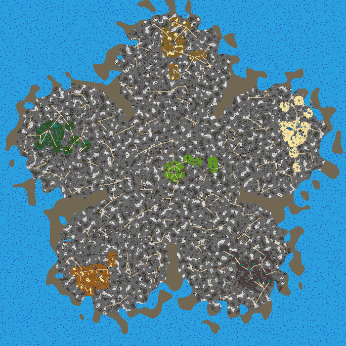
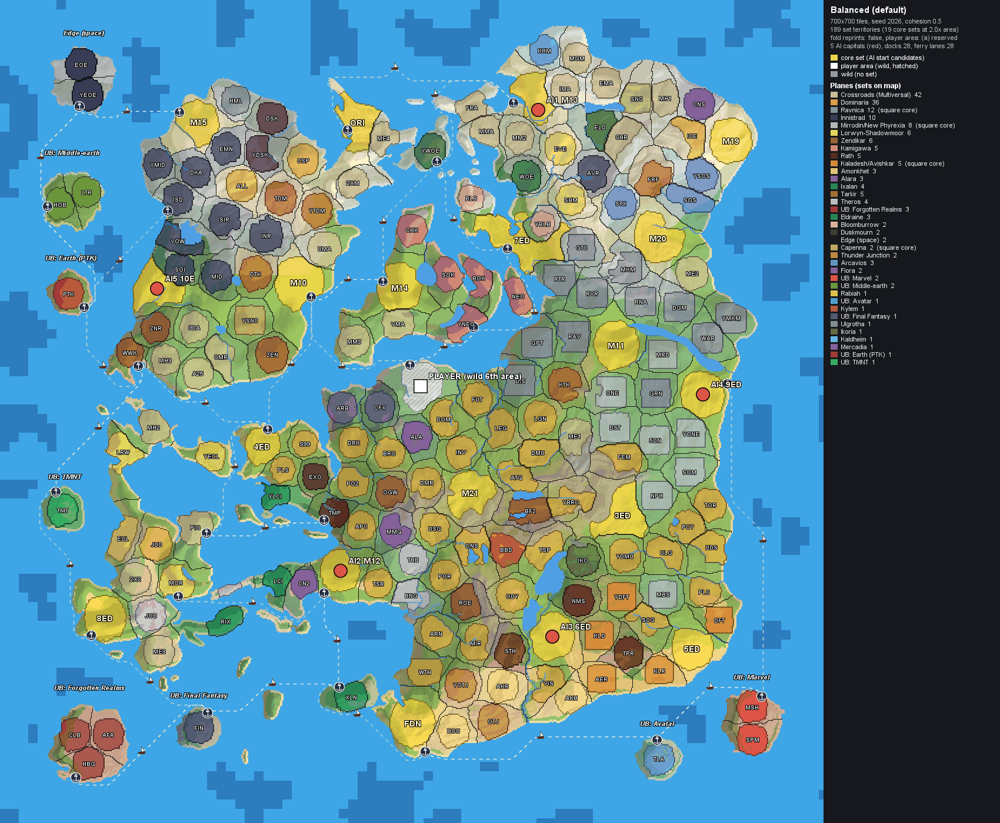
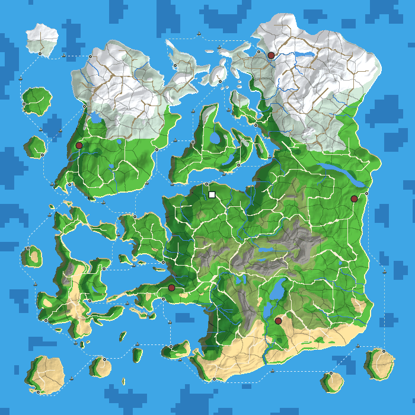
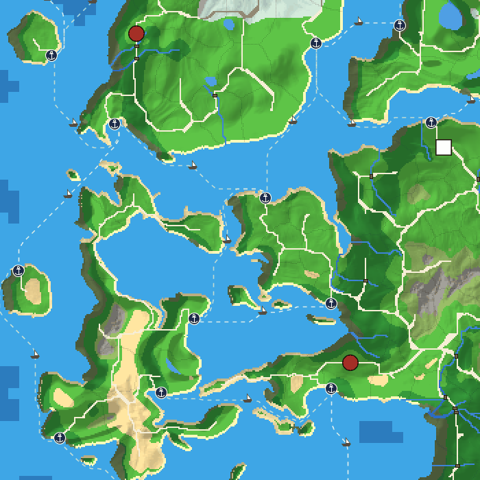
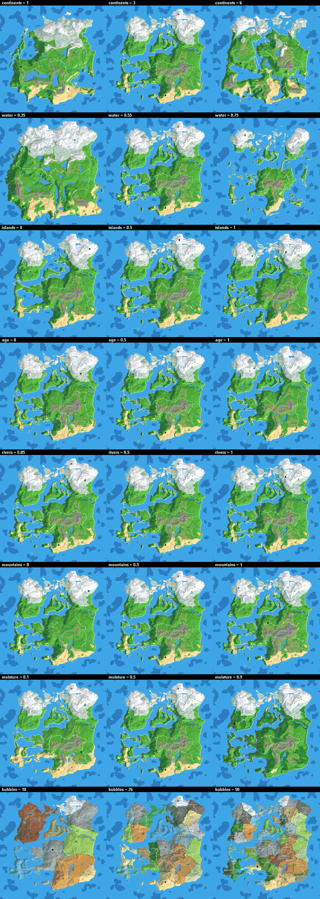
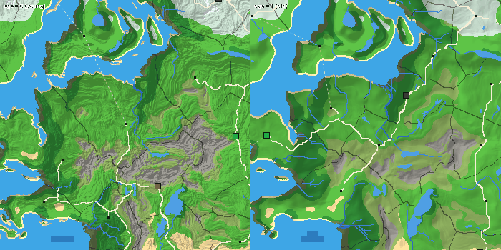
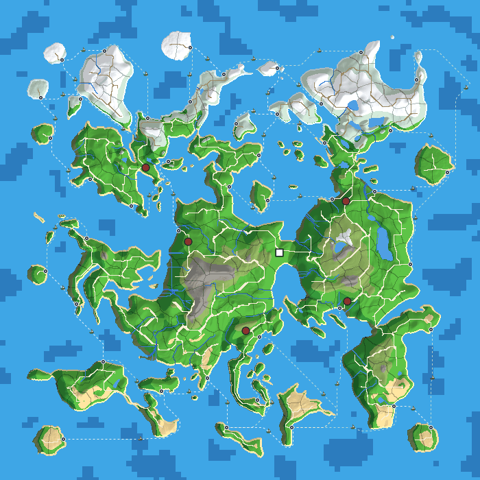
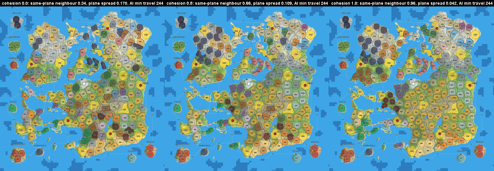
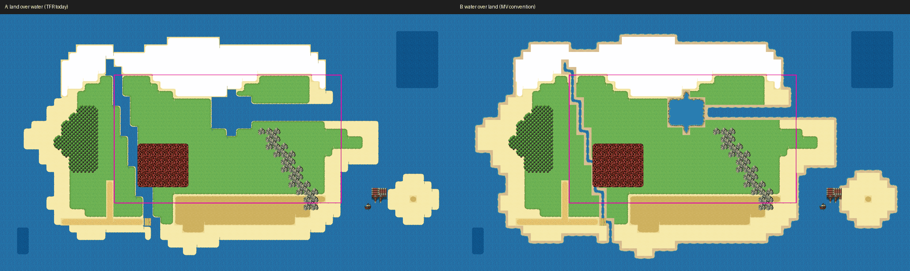

# Procedural world generation for The Forsaken Realms 2 - research and recommendation

*Research doc, 2026-10-17. No game code was changed. Three scratch prototypes were built and measured; the merged one
is kept at `dev-tools/worldgen-prototype/`, outside the build, because the proof of concept in section 7 ports it.
Figures are in `docs/research/procedural-worldgen/`. Every prototype figure is a debug render (flat colors plus
hillshade). The game cannot draw hillshade, so judge the in-game look only from the real-autotile sheet (figure 9).*

**The brief changed during the research, and this doc follows the final version.** It started as "a better overworld
for TFR". It ended as the user's direction for **The Forsaken Realms 2**:
- full procedural rivers and mountain ranges, with no fixed pentagon;
- **one bubble per MTG set**, with core sets getting larger areas;
- a **second layer for AI starting locations**, where each AI starts with one core set;
- AI units' decks are built from the sets they have conquered;
- the player's start is undecided (their own 6th area, or carve one out);
- **harbors and boats**;
- many sliders (Continents, Islands, Water, River, Age of World);
- bubbles spread at random at the start;
- "all new mechanics; don't get boxed in by the current TFR/Forge loops".

---

## 0. The short version

- **Recommendation: Option B, in a "generate once, save the plan" form.** One pure-Java generator runs at New Game
  and makes a new world for every save, driven by a seed and the sliders. Its output is saved as an immutable
  **WorldPlan** and is never regenerated on load. The same code runs headless as a command-line tool for previews,
  batches and tests. Any seed worth keeping becomes a shareable **World Code**, so a curated world (Option A) comes
  free as a "featured seed".
- **Why B.** Three reasons:
  - Sliders, bubbles spread at random and an all-new TFR 2 require generating per game.
  - It is cheap. The merged prototype builds terrain, rivers, set territories, the AI start layer, harbors, ferries,
    roads and a reachability check in **1.3-1.7 s at 700x700 and 2.8 s at 1000x1000** on one thread. Today's world
    generation logs about 22 s.
  - **No offline tool produces what the game needs most: a fair, typed conquest graph for every seed.** Azgaar, Gaea,
    World Orogen and Nortantis are excellent at pictures and at climate, but none of them knows about five AIs, core
    sets or harbors.
- **What to build on.** Write our own generator and borrow proven techniques:
  - Priority-Flood drainage (Barnes 2014);
  - implicit stream-power erosion for Age (Braun-Willett 2013);
  - mapgen4's wind rainfall;
  - Azgaar's cost-based state growth and Urquhart sea routes;
  - VCMI's balanced zones and connection-repair ladder;
  - the Hungarian algorithm for matching sets to territories;
  - FastNoiseLite (MIT) later.

  The offline tools stay benchmarks. Of your starting links:
  - **baturinsky/worldgen** is MIT but untouched since 2020; it is a port reference only.
  - **rharel/cuda-worldgen** has no license and needs CUDA. Reject it.
- **Your model works as stated, and the prototype measured it.** With one territory per set (all 189 editions in
  TFR's reward pool) at 700x700:
  - other sets get **about 33x33 tiles** (28x28 on an archipelago); core sets get about 47x47 (measured 1.92-1.98x);
  - the AI start layer scores all 11,628 ways to seat 5 AIs on the 19 usable core sets in about 0.2 s;
  - every playable landmass gets a harbor;
  - **every territory is reachable**, over land, bridges or ferries, with 0 repairs in all 5 test worlds.

  Figure 2 is that world.
- **The single most important engine decision: conquest must never repaint the land.** Today daily territory growth
  re-rolls the tile content of every tile it claims (J`World.java:6296-6401`), so it would erase any bubble's identity.
  In TFR 2 the plan is immutable, and ownership is drawn as borders, banners and a map tint on top of the land.
- **Art, not the algorithm, is the long pole.** 189 set tilesets are not feasible. About 20 plane "skins" in v1
  (ground, structures, doodads, a landmark), plus per-set identity from the landmark, banner, palette, enemies and loot.
  A real-autotile test (figure 9) shows that drawing water over land, the reverse of today's order, gives readable
  1-tile streams and lakes.
- **Smallest first step:** one session that turns the prototype into a production-shaped generator in `dev-tools/`
  (tests, save codec, timings including an Android-like JVM mode) and renders one crop in real game art. It changes no
  game code (section 7). A separate, small and urgent TFR 1 fix: **today's save has 301 walkable ocean tiles**, because
  roads and the obstacle sweep pave water (section 1.5).
- **Decisions only you can make** are in section 9. The big ones:
  - player start: carve-out or your own 6th realm;
  - the TFR 2 victory condition;
  - how reprint-only sets are handled;
  - whether "Age" also means history.

---

## 1. What we have today (Step 0)

Paths: **J** = `forge-gui-mobile/src/forge/adventure/`, **P** = `forge-gui/res/adventure/The Forsaken Realms/`.

### 1.1 The world format

| Item | Today | Where |
|---|---|---|
| Size | 700x700 tiles, 16 world units per tile, drawn with 32 px art (`terrainScale` 2) | P`world/world.json`; P`config.json:279`; J`world/World.java:4883` |
| Chunks | 30x30 tiles (`max(480,270)/16`). Doodads and POIs past tile 690 are **silently dropped** (700/30 = 23 chunks) | J`World.java:7507`; `SpritesDataMap.java:84`; `PointOfInterestMap.java:35` |
| Ownership | `long[700][700] biomeMap`, one bit per biome in world.json order: 0 ocean (set on **every** tile), 1 waste, 2-6 W U B R G, 7 player, 8 road, 9 player road. The owner is the highest set bit | J`World.java:1099`, `2241-2251` |
| Tile content | `int[700][700] terrainMap`: bit 31 collision, bit 30 structure, low bits = an index into the owner biome's own table (0 ground, then terrain bands, then each WFC structure mapping) | J`World.java:51-53`, `2230` |
| Mountains | `barrierMap` (a saved BitSet): impassable mountain wall, drawn with the high-res `barrier_mountains.png` pieces | J`World.java:2507-2658`; J`world/BarrierMountains.java` |
| Saved | biomeMap, terrainMap, barrierMap, the minimap PNG (2800x2800), doodads (`mapObjectIds`), POIs, seed, fog `explored[][]`. **Loading never regenerates**: an old save keeps its world forever | J`World.java:1148-1193`, `1482-1580` |
| Memory | Minimap and fog pixmaps are 31 MB each at 700x700 (RGBA8888), plus GPU texture copies. They scale with area: about 64 MB each at 1000x1000 | J`World.java:3711`, `7417` |

### 1.2 The generation pipeline: `World.generateNew(long seed)`, J`World.java:2757-3834`

1. **WFC structures** (async): per biome structure, an `OverlappingModel` (N=2) from an 8-16 px sample PNG, solved in independent **10x10-tile chunks** (`BiomeStructure.java:21`), gated by a 127x127 circle or ring mask.
2. **Pass A, biome claims** (2939-2970): a tile joins a biome when `noiseWeight*n + distWeight*dist/R < 1`, with one OpenSimplex field at zoom 30. Ocean claims everything. The wasteland is a 208-297-tile disc at the center. The five colors are 82-163-tile discs on an **exact regular pentagon**, 210 tiles from the center (round 295).
3. **Barrier** (2507-2576): every land tile outside the six structure circles becomes impassable mountain. That makes the flower: a hub, five petals and an 18-tile wall between neighbors.
4. **POIs** (3010-3214): about 2,362 placed, from 440 definitions. Up to 500 polar samples per POI inside its biome's ellipse; a failed essential restarts the whole pass. Castles, Orazca, Spawn and the Ring Cities sit at fixed offsets (every castle 259 tiles from the Capitol, the user's round-295 fairness ask).
5. **Pass B, tile content** (3242-3358): terrain bands, then the WFC structure index. Color tiles more than 20 tiles from their castle get wasteland content.
6. **Roads** (3366-3701): nearest-town graph drawn as straight 4-connected Bresenham lines that zero `terrainMap`, so they cut forests and cross water.
7. **Minimap bake, doodads** (`placeAllDoodads`, 6566): the first sprite in the owner biome's `spriteNames` that passes its noise band and density roll. `DOODAD_DENSITY_MULTIPLIER` (6251) is now `1f` and only matters for the territory-growth ring re-scatter.
8. **Territory Control sweep**: every color is cut back to its 20-tile keep; then edition shards and an obstacle sweep around every place.

The only timing on record is about **22 s on desktop, 16.5 s of it in Pass B** (agent log, round 290, before the barrier existed). Android has never been measured.

**Generated vs hand-authored.** Hand-authored: world.json, the eight biome JSONs (start points, weights, terrain bands, WFC samples and masks, doodad lists), 440 POI definitions, every tileset and atlas. Generated per save: the claims, barrier, POI positions, tile content, roads and doodads. **Nothing in the engine models elevation, water flow, rivers, temperature or moisture**: a search of J for river, elevation, heightmap, moisture, temperature, erosion and watershed finds nothing.

**Rendering.** Tiles are drawn lazily per chunk from the saved arrays. Each set biome bit draws bottom-up with an RPG-Maker-XP-style quarter-tile autotile (a 3x4 region plus 48 quarter tiles, so any 8-neighbor mask works) (`BiomeTexture.java:150-486`). There is no coast transition (the land rim sits over the sea), no shallow or deep water, no river, bridge, dock, snow or cliff art in the plane. Converted but unused autotiles exist in `dev-tools/world-art/autotiles` (deep_sea, ice_water, snow ground, snowy forest, sea rocks), and the Art Library holds unconverted sheets with shallows, waterfalls and snow.

### 1.3 What the current world looks like

Rendered from the user's slot-1 save (day 7): a five-petal flower that is **43.2% ocean and 50.9% wasteland**. Each color owns about **0.8%** of the map (a 20-tile disc) and grows daily to 40-49k tiles each by day 210.

*Figure 1. Today's world: the five-petal flower, gray wasteland, the barrier mountains along the coast, straight roads.*

### 1.4 The seams (and why they matter less now)

For a patch to TFR 1, the clean seam is to replace Pass A (2939-2970) and `computeBarrier` (2507-2576) with an importer, keeping the rest. Every downstream pass reads only `biomeMap`, and the barrier is already a saved, claim-proof, POI-free, road-free mountain layer with its own art. A new `world.json` field must be declared in Java first: the loader is a strict libGDX `Json` (J`World.java:1128`, no `setIgnoreUnknownFields`).

For TFR 2 these seams are the wrong frame. The user wants a different world model (set bubbles, AI starts, harbors), not a better Pass A. Section 6 builds a new module and uses the old pipeline only for what it does well: chunked rendering, autotiles, place maps, duels.

### 1.5 Traps any new generator must handle (each verified in code)

1. **Conquest erases terrain.** Daily growth (`claimOneTile`, J`World.java:6296-6401`) zeroes and re-rolls `terrainMap` on every claimed non-road tile. Town capture translates structures (5650-5684). Any themed bubble ground in `terrainMap` disappears as factions grow, unless ownership becomes a separate layer.
2. **Water is not protected.** Ocean tiles carry bit 0, but several guards test `(bits & ~roadMask) == 0` (5368, 5423), and roads, plazas, corner joins and the obstacle sweep have no water test. The user's slot-1 save has **301 walkable ocean tiles**. Rivers and lakes need a real `isWater` predicate first. *(Fixed for TFR 1 in round 690: `World.isWaterRaw` + `sealSea`; roads over water stay walkable as causeways.)*
3. **Rivers become borders.** Since round 654, claims must touch the owner 4-way (6134). A 1-tile river is a hard border and leaves unclaimed shadows behind it, because the ring only rescans the new annulus (`TerritoryControl.java:929`).
4. **Biome bits are not a region system.** Adding or reordering biomes shifts the road bits and breaks saves. `highestBiome` caps at 61 biomes plus 2 road bits, so 146-189 set bubbles can never be biome bits.
5. **Per-save parameters have no home.** `WorldData`/`BiomeData` are process-wide caches, not saved. New Game+ calls `generateNew(0)` in place (`SaveLoadScene.java:388-395`).
6. **World size.** Changing world.json width loads old saves but drops or crashes doodads near the edge (World.java:1177). A size slider needs per-save sizing.
7. **Strict data, silent failure.** `WorldData.GetBiomes()` swallows a `SerializationException` and returns a shorter biome list (WorldData.java:115-129). Any new data format should fail loudly.
8. **Upstream merge.** World.java is 7,536 lines against upstream's 970 (+7,283/-717). It is effectively mod code; new work belongs in new files.
9. **No water crossing exists.** No boat, dock, ferry, bridge or ford anywhere in J. Islands today are flight- or teleport-only, and AI mages walk straight over the sea.

---

## 2. The target and what the direction implies

### 2.1 The reference picture

The user's reference (an r/GameArt post, "current map of my game world") was supplied as a screenshot. Reddit is
blocked for our tools, so the picture is described here and not copied into this public repo. It is a top-down
pixel-art overworld:
- **the sea:** a bright cyan sea with blocky darker deep-water patches;
- **land:** one large landmass broken into sub-areas, plus about 15 islands, each ringed by a sand beach;
- **climate bands:** snow in the north, desert in the south-center, green everywhere else;
- **many small themed areas:** stamped squares and blobs with their own ground (a black lava square, a blighted
  square, a gray stone town, an ice palace);
- **people:** dense path networks, many small settlements, docks with boats;
- **rivers:** thin and few;
- **mountains:** barely present.

It is gameplay-first, not geological.

Measured on the screenshot, the themed stamps span about 4-15% of the map's width. That is 30-100 tiles at 700, and
small clearings are about 2%. At 700x700 one set bubble is 33-37 tiles across (about 5% of the width), which matches
the small and medium stamps. The large themed regions come from neighboring sets of the same plane clustering
together (the cohesion setting, figure 8).

Two consequences:
- **Default Mountains to Low.** Ranges stay as borders and chokepoints, not as the look.
- **Spend the effort on water and coasts:** beaches, shallows, deep patches, rivers and harbors. That is what makes
  the reference read.

### 2.2 What the direction implies

1. **The board is a graph.** If AIs conquer set by set, the generator must emit more than tiles: a **board graph**
   of territories and their crossings, plus the tiles. Each crossing has a type: land border, bridge, ford, mountain
   pass or ferry lane. Rivers, ranges and harbors become strategy (chokepoints), not decoration.
2. **Land and ownership are two layers.** In TFR 1 a "biome" is the owner, and conquest repaints it. In TFR 2, a
   territory's set and theme are fixed for the life of the world. Who holds it is a separate, changing layer drawn on
   top (section 5.7).
3. **Set count decides bubble size.** TFR's reward pool holds **189 editions** (log line
   `[TFR-Research] 189 of 194 boosterable editions hold cards`):
   - 19 usable core sets and 114 expansions;
   - 17 Alchemy sets, which belong to their parent's setting;
   - 9 plane remasters (TSR, DMR, KLR...);
   - 17 generic Masters and reprints with no setting of their own (CHR, ME1-4, MMA, VMA, MM2, EMA, MM3, IMA, A25, UMA,
     2XM, 2X2, 30A, PIO);
   - 13 Draft and Starter products (MH1-3, CNS, CN2, BBD, CMR, CLB, LTR, POR, PO2, PTK, S99).

   Measured in the merged prototype (water 0.55 unless noted; the side is the square root of the median area):

   | Variant | Territories | Other sets, median | Core sets, median | Smallest |
   |---|---|---|---|---|
   | All 189, Balanced, 700 | 189 + player area | 1,125 tiles (33x33) | 2,228 (47x47) | 282 (THS) |
   | All 189, Archipelago, 700 (water 0.67) | 189 + player | 797 (28x28) | 1,527 (39x39) | 397 |
   | All 189, Pangaea, 700 (water 0.45) | 189 + player | 1,333 (36x36) | 2,621 (51x51) | 893 |
   | Folded to 146, Balanced, 700, no player area | 146 | 1,436 (37x37) | 2,755 (52x52) | 812 |
   | All 189, Balanced, 1000 | 189 + player | 2,321 (48x48) | 4,500 (67x67) | 740 |

   **Pacing.** Walking is 2.5 tiles a second and the view is about 30x17 tiles. A 33-tile territory is about 13 s on
   foot, a little over one screen wide. That suits "little bubbles". Whether it is fun to *conquer* 146-189 of them is
   a pacing question for the conquest design, not the generator (section 9).
4. **Art follows the plane; identity follows the set.** About 36 MTG planes cover the 189 editions. Dominaria (35)
   and the Multiversal bucket (47, core sets and generic reprints) are the two big buckets. Ground, structure and
   doodad art is keyed to the plane. Each set gets its landmark, banner and set symbol, a palette shift, its enemies
   and its loot. No machine-readable set-to-plane field exists: MTGJSON has only `block`, and Scryfall's block stops
   in 2019. The mtg.wiki set infoboxes (`plane=`) map 110 of 115 expansions, and Forge's own Planar Conquest data
   (`res/conquest/planes`, 30 planes) covers 94 of the 189. A hand-checked `sets.tsv` of about 190 rows (about 50 of
   them filled by hand) is the answer. The prototype already has a first version.

The r/godot post the user linked ("How I learned procedural generation in Godot") was found in the Wayback Machine
(captured 2026-08-18). It is a fly-fishing roguelike's developer describing ponds made from noise, a falloff and a
threshold, using the MIT "Gaea" Godot add-on (not QuadSpinner's Gaea). It is fine as a primer but adds nothing at
this scale.

---

## 3. Candidates

### 3.1 Comparison: top eight

Last-commit dates and licenses come from `gh api` on 2026-10-17; the license and output claims were checked against
primary sources by an adversarial verifier.

| Candidate | Quality vs the target | Last commit | License | Language and fit | Outputs | Control and hand-editing | Effort | Role in TFR 2 |
|---|---|---|---|---|---|---|---|---|
| **Own Java generator** (the merged prototype, `dev-tools/worldgen-prototype`) | Closest to the target (figures 2-4 and 7): beaches, deep patches, climate bands, downhill rivers (0 dead ends), ranges, set territories, harbors | 2026-10-17 | ours (GPL-3.0, the repo's) | Pure Java 17, no AWT in the core; runs in the game and headless | In-memory arrays plus the board graph; PNG and metrics for review | Every slider; per-stage seeds; World Code; edit by re-rolling a stage | 1 session to production shape, then rounds R3-R9 | **Adopt** |
| **Azgaar's Fantasy Map Generator** | Best semantic layer (states, provinces, burgs, routes, rivers). Its look is vector cartography, not tiles | 2026-10-16 (v1.154.2) | MIT plus a clause freeing generated maps, including commercial use (GitHub shows NOASSERTION) | TypeScript in the browser; no headless mode | .map, Full JSON (cells, rivers, routes, burgs), GeoJSON, PNG/SVG | Templates, locks, brush editors; seeds change between versions; max 100k cells (about 4.9 tiles per cell at 700) | Import path 3-5 days, but no fair conquest graph per seed | **Borrow techniques** (expandStates, provinces, Urquhart routes); benchmark |
| **Red Blob mapgen4 / mapgen2** | Painterly relief; rivers by drainage; wind rainfall with rain shadow | 2026-03-29 (marked unmaintained) | Apache-2.0 | JavaScript; no data export | None (screen only) | Paint-to-constrain elevation | n/a | **Borrow techniques** (wind rainfall, drainage); reference articles |
| **VCMI random map generator** (open-source Heroes 3) | Not a terrain tool: the best answer to fair, typed zones on one map | 2026-10-17 | GPL-2.0-or-later | C++ | Zone templates (JSON); in-game maps | Templates: zone sizes, types, connections (guarded, wide, port) | n/a | **Borrow techniques** (capacity-balanced zones; land, then water, then portal connection ladder) |
| **Guy-Shalev/terrain-generator** | Strong physical model: plates, erosion, wind rain shadow, Holdridge biomes | 2026-10-10 (created 2026-07-26, 24 stars) | MIT | Python, numpy/scipy, offline | height16.png, lakes16.png, biome.png, canopy.png, **rivers.json with widths**, config.json | About 100 config fields; no image authoring | 0.5-1 day to run and convert | **Benchmark and port reference** for climate and hydrology; too young to depend on |
| **World Orogen** (`raguilar011095/planet_heightmap_generation`) | Strongest climate found (pressure-band wind, orographic shadow, Köppen); planet scale | 2026-07-03 | GPL-3.0 (outputs are free) | Browser JS; equirectangular planet | PNG up to 65,536 px wide (satellite, Köppen, heightmap, land mask); **no river export** | 15 sliders; import your own heightmap | 1 day to crop and convert one continent | **Visual and climate benchmark** |
| **Nortantis** | Hand-drawn atlas maps; political-region brush | 2026-10-03 | AGPL-3.0 (maps you make are not covered) | Java, compiled to Java 17 bytecode; Swing desktop | Images; its own map format | Strong hand-editing (regions, land, rivers) | n/a at runtime | **Reference** for Java map code; not a runtime dependency |
| **Gaea 2 / World Machine / Wilbur** (pro baseline) | Photoreal erosion detail, invisible at 1 pixel per tile | Gaea 2.3 (2026-05); World Machine Build 4065 (2026-07); Wilbur 1.92 (2023-09) | Gaea Community and WM Basic free for **non-commercial** use only (about 1024 px cap); Gaea Indie about $99 (under $100k revenue, games allowed); Wilbur freeware | Windows desktop, offline | 16-bit heightmaps, masks (flow, erosion, water) | Node graphs; hand-editable | 1-2 days per curated heightmap | **Reject for TFR 2** (cannot be driven per world); fine for a one-off key-art map |

### 3.2 The starting links

| Link | Finding | Verdict |
|---|---|---|
| [baturinsky/worldgen](https://github.com/baturinsky/worldgen) (the "main find") | MIT, last commit 2020-06-28, 88 stars. A compact raster terrain and climate pipeline with a square-grid "game map" view, the closest of all to a 16 px look. No export, no hand-editing. In grid mode rivers are straight channels and roads straight diagonals, some across open water. | **Port reference only.** About 1,000 lines of MIT raster code to read; superseded by Azgaar (heuristics) and Red Blob (formulas). |
| [rharel/cuda-worldgen](https://github.com/rharel/cuda-worldgen) | **No license file** (headers say all rights reserved). Needs an NVIDIA GPU, the CUDA toolkit, OpenCV and MSVC. Untouched since 2022-06-02. | **Reject.** Its ideas (lake water levels, rainfall-weighted rivers) are covered by MIT/Apache sources. |
| The r/GameArt target map | Seen from the user's screenshot; see 2.1. | The look to aim for. |
| The r/godot learning post | Found in the Wayback Machine; see 2.2. | Primer only. |

### 3.3 Also checked (one line each)

- **WorldEngine** (MIT, revived with v0.20.0 on 2025-11-18): plate tectonics through platec (LGPL). Its README claims
  rain shadows, but `precipitation.py` is noise times a temperature curve. Weaker than World Orogen or
  terrain-generator.
- **SquidSquad** (Apache-2.0, JVM, libGDX-friendly): good world-map classes, but the river and lake generation in
  `WorldMapGenerator` is commented out. Borrow ideas only (MimicLocalMap, PoliticalMapper).
- **FastNoiseLite** (MIT, one Java file, domain warp, cellular and ridged fractals): adopt as the noise layer in R3,
  once its `Math` calls are audited for determinism.
- **Unciv** (MPL-2.0, Kotlin, libGDX, Android): the best precedent for a New Game screen with a live preview that is
  cancelled on every change, and for landmass presets.
- **Landlab, StreamPowerErosion (Schott et al. 2023), fastscape, WhiteboxTools**: offline erosion and hydrology. The
  prototype's half-resolution implicit stream power gets the visible effect in about 100 ms.
- **Cartogenesis** (MIT, Kotlin, created 2026-08-23, 1 star): an impressive full physical simulation, about 13 s per
  world. Too new to depend on.
- **Undiscovered Worlds** (GPL-3.0, dormant since 2024-09) and **Tectonics.js** (CC-BY, stale since 2020): reference
  only.
- **Sebastian Lague**'s erosion and landmass series (MIT): good tutorials. Droplet erosion is sub-tile detail.
- **Wave Function Collapse** (already in Forge): it solves in independent 10x10-tile chunks (`BiomeStructure.java:21`),
  so it can never make a river or a range. At most it decorates inside a class mask.
- **Terrain Diffusion and other ML terrain** (MIT, 2024-2026): real and well licensed, but it solves a resolution
  problem TFR does not have, and needs a GPU.
- **Watabou Perilous Shores** (outputs free to use commercially), **Wonderdraft**, **Inkarnate**: art tools that
  produce pictures, not data. Inkarnate's Free and Creator licenses forbid publishing.
- **Tiled**: not for painting the overworld tile by tile, because the overworld is not a TiledMap. It stays the tool
  for landmarks and towns (TMX places).

### 3.4 Licensing in one paragraph

Forge and TFR are **GPL-3.0** (`LICENSE`; `gh` reports Card-Forge/forge and TheSAguy/The-Forsaken-Realms as GPL-3.0),
so GPL-3.0 and AGPL-3.0 code is legally combinable, though MIT and Apache-2.0 are simplest. A GPL tool's *output* is
not GPL-encumbered. Repositories with **no license** are all rights reserved and must not be copied: cuda-worldgen,
SimpleHydrology, the Barnes 2013 reference code, Java-Delaunay, countercheck/worldgen and the Minecraft "tectonic" mod.
The free tiers of Gaea and World Machine are non-commercial only. The mtg.wiki plane facts are CC BY-NC-SA 4.0: use
the facts, never its text.

---

## 4. The decision: A, B or C

| Option | What it would mean here | Verdict |
|---|---|---|
| **A** One curated world, made offline and imported | Every player learns one map. No sliders, no random spread. New Game+ repeats the map. | **No.** It contradicts the direction. It survives as a *featured World Code*: any generated world worth keeping is shareable. |
| **C** Offline macro map plus runtime detail | Step 0's seam reader recommended this *for TFR 1*: replace Pass A and the barrier with an importer and keep the rest. For TFR 2 the sliders must drive the macro shape, and the runtime systems (territories, harbors, AI starts) cost the same either way. | **No for TFR 2.** It was the right answer to "improve TFR 1's flower", which is no longer the question. |
| **C'** A pool of 3-5 curated macro maps | Variety without sliders. It still needs every runtime system B needs, and adds a second toolchain the sliders cannot drive. | **No.** All of B's cost, without its benefit. |
| **B** Runtime Java, a new world per save | Sliders, random spread, one toolchain; cheap in time (1.3-2.8 s measured). | **Yes**, in the "generate once, save the plan" form below. |

Two notes on B:
- **B already exists in TFR 1.** `generateNew(seed)` runs per save. What it generates is a fixed template with noisy
  edges, so the real change is the *model* (geography, territories, harbors), not "runtime vs offline".
- **"Generate once, save the plan" removes B's usual risks.** Loads never regenerate (TFR 1 already works that way),
  so a later generator change can never alter an existing save. Floating-point drift between desktop and Android can
  only affect World Codes, and those carry a generator version.

---

## 5. The recommended design

### 5.1 What the generator produces

**WorldPlan** (immutable, saved) and **PlanState** (mutable, saved).

| Layer | Per tile | Notes |
|---|---|---|
| height | 1 byte | sea level stored in the header |
| class | 1 byte | deep sea, sea, lake, stream, river, great river, beach, grass, dry grass, desert, dunes, tundra, snow, swamp, forest kinds, jungle, hills, mountain (impassable), volcano |
| flags | 1 byte | river tier, bridge, ford, road, dock, themed-core mask, landmark-immune |
| territory | 2 bytes | 0 sea, 1 wild, 2..N set territories |

That is about 2.5 MB raw at 700x700. The deflated size is still to be measured (section 7).

On top of the tiles, as tables:
- **territories:** set, plane, core flag, area, seat, landmark, POI slots, harbor sites;
- **plane realms;**
- **the board graph:** typed edges with crossing tiles and travel seconds;
- **harbors and ferry lanes;**
- **the AI start layer and both player options;**
- **settings and seed,** which make the World Code;
- **metrics.**

**PlanState** holds the owner of each territory, crossing states, dock unlocks and a flip log.

**Map size.** Snap to the 30-tile chunk: **Standard 720x720** for the brief's 700 and **Large 1020x1020** for its 1000.
At a plain 700 the doodad and POI maps silently drop everything past tile 690, essential POIs included. The measured
numbers in this doc are at 700 and 1000; 720 and 1020 are about 6% and 4% larger.

### 5.2 The pipeline, with measured times

The merged prototype: median of 3 warm runs, one thread, a desktop Ryzen 7 7800X3D, in ms.

| Stage | Algorithm | Balanced 700 | Balanced 1000 |
|---|---|---|---|
| S1 Landmass | Continents as the max of 3-5 domain-warped blobs; a strait cut where continents overlap; open-sea islands; sea level by water quantile | 177 | 348 |
| S2 Ranges and Age | 6+2C warped Voronoi plates, ridged uplift at convergent boundaries; at half resolution, Priority-Flood plus implicit stream power for 1+10*age passes, then thermal slumping | 153 | 311 |
| S3 Coast and isles | Inland seas above 0.4% of the map; lakes from deep basins; Universes Beyond isles placed **after** sea level by a distance transform on the real water | 86 | 173 |
| S4 Climate | Latitude, lapse rate and noise; a westerly rainfall sweep with rain shadow (mapgen4); class lookup; beaches 2-4 tiles | 125 | 245 |
| S5 Hydrology | Priority-Flood + epsilon (Barnes 2014); rain-weighted D8 flow; river tiers by discharge quantile; stubs pruned; 4-connected for autotiling | 54 | 109 |
| S6 Territories | Core-set seeds first by farthest point; others by best-candidate; capacity-balanced multi-source Dijkstra (river +10, ridge +6, water impassable); themed core per territory | 385 | 808 |
| S7 Sets and realms | Plane realms on the territory graph; Hungarian assignment of sets with a climate-fit and cohesion cost (1-3 ms) | 20 | 33 |
| S8 Harbors and ferries | Docks scored per (territory, water body); a sea-Delaunay graph from one multi-source Dijkstra over water; MST plus Urquhart shortcuts plus spurs | 33 | 60 |
| S9 AI start layer | All C(19,5) = 11,628 combinations scored; the top 40 re-scored by travel-cost Voronoi share | 202 | 169 |
| S10 Roads and crossings | A* over terrain cost and low-frequency noise; MST plus loop links plus dock roads; bridges where roads cross rivers; passes | 243 | 520 |
| S11 Validate | BFS over land, bridges and ferry lanes to every territory hub; repair ladder: pass, then bridge or ford, then ferry, then portal | 5 | 9 |
| **Total** | | **1,489** | **2,787** |

- **Determinism.** One SplittableRandom per stage, from `mix(seed, stageId)`, so tuning one stage never reshuffles the
  others. StrictMath. No HashMap iteration.
- **Not like for like.** The 1.5 s is the generator alone. Building the game world from the plan (skins, POIs from
  slots, doodads, an area-averaged minimap) is still to be measured, but it replaces most of today's 22 s: Pass B, the
  WFC solves and polar POI sampling are all skipped.
- **Android has never been timed.** The proof of concept brackets it with C1-only and interpreter runs.

### 5.3 Set territories

- **Default "Fold Alchemy and remasters": 163 territories.**
  - The 17 Alchemy Y-sets fold into their parent set.
  - The 9 plane remasters (TSR, DMR, KLR...) fold into their plane's set.
  - The 17 generic Masters and reprint sets keep their own territories as neutral **Crossroads** land and can never be
    an AI seat.

  The prototype instead folded the generic masters onto the nearest core set. That puts high-power reprint pools on
  AI capitals, against era fairness, so it is not recommended. Expected bubble size at 163 is about 35x35. That is
  interpolated between the measured 146 and 189.
- **Options:** All (189, Alchemy included; Large map recommended) / Fold all (146, generic masters ride on core sets)
  / Compact (about 100, sampled as whole planes). Compact is not measured yet; pick it only if the conquest simulation
  says games run too long.
- **Core sets at 2x** (an Advanced slider, 1.5-3x). All 19 usable core sets are on the map. The 14 that no AI holds
  become big prize territories.
- **Themed core.** Each territory has one: the "little bubble" of the reference, grown from the landmark seed and
  stopped by rivers and ridges. Coverage is an Advanced slider, 30-60%, default 45%. Urban planes (Ravnica, Capenna,
  Kaladesh, Mirrodin) and AI capitals get square cores, like the reference's stamped squares.
- **Cohesion: how strongly a plane's sets cluster.** Default Mixed (0.5); figure 8 shows the effect.
  - The same-plane neighbor share is 0.34 at 0, 0.66 at 0.5 and 0.96 at 1.
  - Core sets are exempt, so AI spacing is identical at every setting (244 travel units).
  - For a truly random "Scattered", the climate-fit weight must fall with cohesion too. Even at 0 the prototype keeps
    34% same-plane neighbors, from shared climate.
- **Bounded climate nudge.** About 80% of bubbles need one (±0.3) so that, for example, Kaldheim reads as snow. Climate
  is a soft guide that the theme skin overrides locally, never a reason to reject a world.
- **Minimum-area reseed.** Add one: the prototype's smallest territory (THS, 282 tiles) is a quarter of the median,
  boxed in by rivers.
- **Universes Beyond and Edge sets** (Middle-earth, Marvel, Final Fantasy, TMNT, Avatar, Forgotten Realms, Three
  Kingdoms, Edge) get their own moated isles, reached by ferry. That gives harbors a purpose and keeps franchise art off
  the MTG continent. A setting offers Isles / Mixed / Off.

*Figure 2. Balanced, 700x700, seed 2026, all 189 sets:*
- *core sets in gold (AI start candidates); AI capitals as red dots;*
- *the player's reserved 6th area, hatched;*
- *Universes Beyond isles around the rim;*
- *docks (anchors) and dashed ferry lanes.*

### 5.4 The AI start layer and the player's start

- **The AI start layer is the user's separate second layer,** computed **after** the partition. It chooses K seats
  (default 5, range 2-8) among the core-set territories by scoring every combination. 11,628 for 5 of 19 take about
  0.2 s; 8 AIs means 75,582 combinations, not yet run. The score:
  - travel-cost spacing;
  - land within reach;
  - neighbor count;
  - a travel-cost Voronoi land share.

  Three terms are still to add:
  - **habitability**, so no seat lands on snow;
  - **era match**, so a 4ED sealed pool does not face FDN;
  - **a harbor within 3 hops** as a requirement, not a weight.
- **Measured fairness.** Balance is min/max across the 5 AIs, so 1.0 is perfectly even. All four figures are shown,
  not just the best:

  | World | Voronoi share | Land within reach | Neighbors | Harbor access |
  |---|---|---|---|---|
  | Balanced 700 | 0.78 | 0.70 | 0.71 | 80% |
  | Archipelago 700 | 0.77 | 0.84 | 0.83 | 100% |
  | Pangaea 700 | 0.90 | 0.58 | 0.57 | 80% |
  | Fold 146, no player area | 0.90 | 0.87 | 0.67 | 100% |
  | Balanced 1000 | 0.48 | 0.66 | 0.57 | 100% |

  The 1000 run's 0.48 also had a central player area holding 27% of the Voronoi land. The prototype placed the player
  area at the center; whether that caused the drop is not proven. The validator should require at least 0.75 on the
  first three measures for Balanced-type presets, and print the numbers on the New Game preview.
- **The player's start: store both options in every plan.**
  - **Own Realm:** a reserved, core-sized wild cradle. Place it as a *peer*, at about the median AI distance. The
    prototype put the cradle at the center, where it took 7-27% of the land share (27% at 1000) and acted as a hub.
  - **Carve-out:** the top 5 pockets, each at least 3 hops from any AI with at least 3 unclaimed territories within 2
    hops.

  Order of operations: reserve two or three cradle candidates when core seeds are placed (S6). After S9 picks the AI
  seats, keep the candidate closest to the median AI distance. Unused candidates revert to wild land.

  **Recommendation:** build carve-out first. It gives the draft-like opening ("you arrive with nothing, take your
  first set"), and Own Realm is the gentler difficulty option. The choice is the user's (section 9).

### 5.5 Harbors, boats, bridges, fords and passes

Water is a hard wall in TFR today (`base.json` has collision). There is no boat, dock, ferry, bridge or ford anywhere
in the code, and AI mages walk straight over the sea. The generator guarantees **structural reachability**: in all 5
test worlds, 100% of territory hubs were reached before repair. That relies on:
- A* roads that cross rivers only at **bridges**, placed where a road meets a river (20-54 per world);
- **fords** at low-discharge points;
- **passes** carved at the lowest saddle wherever a range would split a landmass;
- **docks**: at least one on every playable landmass (17-43 per world);
- **ferry lanes**: an MST over the landmasses, plus Urquhart shortcuts that cut a detour by 1.6x or more, plus spurs
  (13-39 per world). 14-67 territory hubs per world are reachable only by ferry.

*Figure 3. Balanced terrain in the reference palette: snow north, desert south, beaches, deep-water patches, rivers,
A* roads, AI capitals, docks and ferry lanes.*

*Figure 4. A 2x crop: anchors are docks, dashed lines with boats are ferry lanes, brown planks are bridges.*

Runtime traversal, in tiers:
1. **v1 (required before islands or blocking rivers ship).**
   - Streams are walkable. Rivers block except at bridges and fords. Great rivers can be crossed only at bridges.
   - Dock POIs with **fixed-route ferries**: pay a [+Gold] fare, fade out with the existing teleport fade, arrive, and
     the clock advances.
   - AI units travel the board graph and use ferries as edges, so nothing walks on water. Owning a harbor is what lets
     a power project force onto an island.
   - Islands can be gated (Distant Isles unlocked by quest or week) if they should not be day-1 content.
2. **Tier 2.**
   - Guarded toll bridges and passes: an enemy holds the chokepoint until beaten in a duel (VCMI guarded
     connections, using RoamingGuards).
   - One **Planar Gate** per territory, unlocked by its key duel. Together they form a planeswalk network, as with
     Wind Waker's Ballad of Gales.
3. **Last.** An owned ship for free sailing. It needs inverted collision, embark and disembark only at docks (Final
   Fantasy 1's rule), sea encounters, sea fog and AI parity. The save format leaves room for it.

### 5.6 Sliders, presets and Age

**Every share is set by quantile, so a slider means the same thing on every seed.** One prototype-C bug to fix: its
ocean lands 2-4 points under the Water slider (isles are carved after the sea-level cut), so re-quantile after the
isles. Prototype A hit within 1 point.

| # | Player control | Range | Default |
|---|---|---|---|
| 1 | Preset | Balanced Realm / Archipelago / Twin Continents / Pangaea / Inland Sea / Shattered Isles / Ancient Lands / Custom | Balanced Realm |
| 2 | Water | 30-75% in steps of 5 | 50 |
| 3 | Continents | 1-6 | 3 |
| 4 | Islands | None / Few / Some / Many / Swarm | Some (the reference has about 15) |
| 5 | Rivers | None / Few / Normal / Many / Lots (0 / 0.4 / 1.0 / 1.8 / 2.8% of land) | Normal |
| 6 | Mountains | Flat / Low / Normal / High / Extreme (1 / 3 / 6 / 10 / 15% of land impassable) | Low |
| 7 | Age of World | Primordial / Young / Mature / Old / Ancient | Mature |
| 8 | Sets in world | Compact / Fold Alchemy and remasters / Fold all / All | Fold Alchemy and remasters |
| 9 | AIs | 2-8 | 5 |
| 10 | Player start | Carve-out / Own Realm | your call |

Next to these: Plane cohesion (Scattered / Mixed / Clustered), Seed with a dice button, a copyable World Code, Map
size (Standard / Large, grayed out on devices that fail a bench), per-control locks, "Randomize unlocked", "Reset to
preset", and a land-budget label (OK / Tight / Over; on Over, "Sets in world" steps down automatically).

**Advanced** (about 14 controls): temperature, rainfall, latitude span, continent size variety, coast roughness,
core-set area, territory size variety, themed core coverage, wild share, Universes Beyond placement, AI core eras,
minimum playable island, bridge density, extra ferry routes. Everything else is dev-only TSV and console commands.

**Why not "a lot" more?** Minecraft's "Customized" screen (versions 1.8-1.12) had about 50 terrain sliders and was removed. Every exposed
slider multiplies the combinations that must stay fair. Ten headline controls plus an Advanced panel gives "a lot of
sliders" without that failure.

**Age of World**, from young to old:
- erosion passes 0 / 1 / 4 / 6 / 9;
- thermal smoothing 0 / 3 / 8 / 12 / 18;
- ridge sharpness 0.9 / 0.7 / 0.5 / 0.3 / 0.15;
- mountain share x1.6 / x1.3 / x1 / x0.7 / x0.45 (mountains turn to hills);
- coast roughness from fjords to beaches and deltas;
- river meander 0.1 / 0.25 / 0.4 / 0.6 / 0.8;
- more lakes and deltas as age rises.

Figure 6 shows young against old on one seed. Civilization uses "world age" the same way (geology); Dwarf Fortress
also has *history* length. **Open question:** should Age also pre-simulate an AI head start or ruins? The bubble-level
territory model makes that cheap; today's per-tile model costs about 0.2 s per simulated day.

*Figure 5. One slider changed per row (prototype A). Water, Continents and the bubble count read clearly at map scale.
Islands, Rivers, Mountains and Moisture are subtle at this size, so tune them for a visible effect before shipping.*

*Figure 6. Age 0 (young: jagged ridges, fewer rivers) against Age 1 (old: rounded hills, more lakes and rivers, wider
beaches), on the same seed at 2x.*

*Figure 7. The Archipelago preset (water 0.67): 20 landmasses, 43 docks, 39 ferry lanes. The closest to the
reference's island ring.*

*Figure 8. Plane cohesion at 0, 0.5 and 1. AI spacing stays at 244 travel units throughout, because core sets are
exempt.*

### 5.7 How it looks

- **Reuse the renderer.** In the TFR 2 plane, `biomeMap` bits mean **skins**: about 12 climate skins plus up to 24
  plane skins, within the 61-bit ceiling. The existing quarter-tile autotiler (`BiomeTexture`) and chunked drawing then
  work unchanged.
- **Ownership never enters `biomeMap`.** It is a double-stroke border, banners and a Political map tint.
- **Draw water over land.** Order the water skins above the land skins. The real-autotile test (figure 9, made with
  `dev-tools/world-art/render.py` and the converted MV A1/A2 sheets) shows today's land-over-water order turning a
  1-tile stream into a canal and merging a lake into the sea, while water over land gives a stream with banks and a
  distinct lake. The A1 edge pieces carry opaque sand halos, so re-convert them with transparent banks.
- **Area-averaged minimap.** Today's minimap takes the top-left 4x4 corner of each tile's art
  (`World.java:4715-4812`), which drops 1-tile rivers. Average the area instead; it is a small, local fix.
- **What reads in the reference:**
  - beaches 2-4 tiles wide;
  - a cyan sea with darker deep patches (more than 18 tiles from land, block size scaled with the map);
  - square stamped cores for urban planes;
  - harbors with boats;
  - path networks.
- **Art budget.**
  - About 20 plane recipes in v1, each a ground, structures, doodads and a landmark, built from the already-converted
    MV kit (`dev-tools/world-art/autotiles`: deep_sea, ice_water, snow ground, snowy forest) plus Art-Library sheets
    (Outside_A1 shallows, UploadSnowA1 waterfalls, World_B, the building pack).
  - Each recipe must pass a color-contrast check: 5 of 12 first-pass recipes failed it.
  - A harbor kit: piers, bridges in 3 materials and 2 orientations, a ship, a lighthouse.
  - Every piece needs CREDITS lines and an Art-Library copy, per the standing rules.

*Figure 9. Real TFR autotiles. Left: today's land-over-water order. Right: water over land, with a river, a lake, a
bridge and a dock.*

### 5.8 Conquest hooks (sketched only)

This needs its own design doc and a simulation.
- **AI unit decks from held sets.** Forge already builds AI decks from booster pools of named sets
  (`AdventureEventData.java` around 540-575, using `SealedDeckBuilder`). A unit's **tier sets the pack count** and its
  **held sets set the mix**, so holdings widen variety without raising power. Otherwise the leading AI snowballs. The
  pack mix and any coalition rule are invented numbers until a conquest simulation over batches of seeds tunes them.
- **Rosters, shops and loot by territory, not by skin.** Keep a `territoryAt(tile)` lookup. In TFR 1, enemy rosters
  and `appearsInBiome` key on the biome bit, which in TFR 2 is a skin.
- **TFR 1's edition shards** (`EditionProgression.seedColorShards`, random per world) become geographic: a power's
  pool is the sets of the territories it holds.
- **Imports pass the cross-plane checklist** (CLAUDE.md): no Commander, no foreign quest lines, no unkept promises.
  That covers landmarks and rosters seeded from Planar Conquest data (641 of its 1,353 events are Commander) or Realm
  of Legends. It also needs checking against the player race's `raceEditions`.

---

## 6. Integration sketch

**Blast radius, stated honestly.** TFR 2 is a **second plane folder** beside TFR 1
(`forge-gui/res/adventure/The Forsaken Realms 2/`), so TFR 1 releases and saves are untouched. The shared engine
(`World.java`, `WorldStage`, `EditionProgression`) still gains `plan != null` branches, so it is a mode of shared code,
not a separate program. Keep those hooks small and tagged. Note also that Forge picks the plane in Settings and
requires a restart today; TFR 2 needs a cleaner entry point (section 9).

### 6.1 Where the code lives

- **Generator:** `dev-tools/worldgen/`, a standalone pom (release 17, no parent, not in the root reactor), with TestNG
  and a plain-javac `build.sh` fallback. Package `forge.tfr.worldgen`.
  - Stages: Landmass, Ranges, Erosion, Coast, Isles, Climate, Hydrology, Classify, Partition, Assign, Cores, PoiSlots,
    Harbors, AiStartLayer, Roads, Validate.
  - Output and tooling: WorldPlan, PlanCodec, PngWriter, DebugRender, cli/Main.
  - **It moves into `forge-gui-mobile/src/forge/tfr/worldgen/` only at R5,** when the game needs it. Until then it is
    outside the game build and its checkstyle.
  - Purity is enforced by the build: the standalone pom has no gdx or JSON dependency, so such imports fail to
    compile, and a source-scan test rejects `java.awt` and `javax.imageio` outside the debug renderer.
- **Game side, at R5:** `forge-gui-mobile/src/forge/adventure/tfr2/`.
  - PlanWorldBuilder: plan to `biomeMap` skins, `barrierMap`, `terrainMap`, roads, POIs at slots, doodads.
  - PlanState.
  - SkinTable: counts the skins and **fails loudly**, because `WorldData.GetBiomes()` swallows a
    `SerializationException` today.
  - PlanEditions (`territoryAt`, editions per territory).
  - MinimapBake (area-averaged), OwnershipOverlay.
  - Later: FerryService, ConquestController, FactionDecks, WorldSettingsPanel.

### 6.2 Existing files that change (hooks only, each tagged `// TFR2`; upstream-shared ones listed in CORE_ENGINE_CHANGES.md)

| File | Change |
|---|---|
| J`world/World.java` (60 lines or fewer) | `plan`/`planState` fields; an early branch in `generateNew` (about 2757) that skips Pass A, computeBarrier, polar POIs, DungeonRotation, Pass B, Bresenham roads and Territory Control; `save()` (1482) writes `tfr2Plan`/`tfr2State`, `load()` (1148) decodes them; 1177-1180 size the chunk maps from the **saved** width |
| J`world/World.java` (water fix, R2, also shipped in TFR 1) | an `isWaterRaw` predicate; fix the guards at 5368 and 5423, `clearObstacles` 2715-2733, `layRoad` 5476-5535, world-gen roads and POI paths 3628-3691, `addPointOfInterestNear` 4116-4146 |
| J`data/WorldData.java` | a declared optional `worldModel` field (the libGDX `Json` reader is strict) |
| J`data/ConfigData.java` | a `planWorldEnabled` flag |
| J`stage/WorldStage.java` 2000-2052 | set the player down off water, as already done off the barrier |
| J`scene/NewGameScene.java` | the World page, for plan planes |
| J`scene/SaveLoadScene.java` 370-395 | New Game+ reuses the saved settings with a new seed |
| J`util/EditionProgression.java` 460-603, J`character/EnemySprite.java` 829-845 | card pools by territory when a plan exists |
| J`util/TerritoryControl.java` | off on plan worlds; audit every day-tick reader of `BiomeData` geometry (claimWastelandRing 5926-5929, addPointOfInterestInBiome 4182, TreasureHunt, repaintBiomeAroundTown 5650-5684, dropDisconnectedTerritory 4555-4569) |
| `ANDROID_RELEASE.md` | the assets must carry the second plane |

### 6.3 Data formats

- **Generator tables are TSV**, so the generator stays free of any JSON library:
  - `sets.tsv`: edition, type, date, plane, fold target;
  - `planes.tsv`: plane, skin, climate ranges, coast or island preference, core shape, clash tags;
  - `presets.tsv` (a new preset is a data row);
  - `constants.tsv`.

  The prototype already reads `sets.tsv` and `planes.tsv`.
- **Game-side render tables are JSON**, declared in Java: `plane_skins.json`, `palette.json`.
- **Save:**
  - a `TFRP` blob: a codec version, a generator version, a themes hash and the settings, then TLV sections (HEIGHT,
    CLASS, FLAGS, TERRITORY, TERRITORIES, REALMS, EDGES, HARBORS, LANES, ROADS, AISTARTS, PLAYEROPTS, METRICS);
  - a separate `TFRS` state blob.

  Unknown sections are skipped; a missing required one is refused with a `[TFR-Plan]` line. The keys are additive, so
  `SAVE_FORMAT_VERSION` stays at 1. No Java serialization: pinned serialVersionUIDs have already caused trouble
  (WorldSave round 144).
- **Logging:** `[TFR-WorldGen]` (settings, ms per stage, counts, repairs), `[TFR-Plan]`, `[TFR-Themes]` (unmapped
  editions), `[TFR-Harbor]`, `[TFR-Ferry]`, `[TFR-Bubble]` (flips), `[TFR-FactionDeck]`, `[TFR-Minimap2]`.

### 6.4 What Forge already gives us (reuse, don't rewrite)

- the duel engine and card database; `CardEdition`; `SealedDeckBuilder`;
- TMX places for seat towns, landmarks and harbor towns;
- `BiomeTexture` and `WorldBackground`; `BarrierMountains` for ranges;
- `SpritesDataMap` doodads (ground-level only);
- the teleport fade for ferries; `RoamingGuards` for guarded crossings;
- fog of war; `Controls.newSlider` and `Selector`;
- gdx-ai and the agent's `WalkController` A* at runtime;
- the agent bridge for soak tests against a known-good baseline.

### 6.5 Order of work

| Round | Content | Gate |
|---|---|---|
| R1 | The proof of concept (section 7) | the user reviews the sheet |
| R2 | Water correctness in `World.java`, **shipped in TFR 1 too** | agent check: no walkable ocean |
| R3 | Generator completion: reseed, habitability and era terms, lane cap, FastNoiseLite, curated `sets.tsv`/`planes.tsv`, a ConquestSim bench over seed batches (set count, AI tempo) | the user decides cohesion, set count and player start |
| R4 | Art gate: tile-truth sheets (layer order, sea palette, core coverage 40 vs 55%), A1 bank re-conversion, about 12 recipes passing the contrast check, harbor and bridge kit at 8x | the user approves the look |
| R5 | Plane hookup: World.java hooks, PlanWorldBuilder, climate skins, POIs at slots, area-averaged minimap, agent soak test | agent screenshot matches tile truth |
| R6 | Traversal: bridges and fords, dock POIs, ferry dialog, territory entry banner | |
| R7 | World settings UI: preset, 10 controls, Advanced, World Code, a background preview reused at Start | |
| R8 | Conquest: PlanState owners, overlay, geographic editions, AI units on the graph, sealed-pool decks, weekly captures, defense bonuses | the conquest design doc first |
| R9 | Android: device timing and memory, determinism goldens on ART, Large gated per device | |
| R10+ | More plane skins (toward 24), landmarks, realm bonuses, Planar Gates, guarded bridges, an owned ship last | |

---

## 7. A proof of concept for one session

**Goal: answer the three riskiest unknowns without touching game code.**
1. Does the generator hold up as production-shaped code (deterministic, saveable, tested)?
2. Does water over land, in real TFR autotiles, read like the reference at game scale?
3. Is it fast enough on an Android-like JVM?

**Steps**
1. `dev-tools/worldgen/`: a standalone pom plus `build.sh`. Port `dev-tools/worldgen-prototype/src` into
   `forge.tfr.worldgen` stage classes.
   - One RNG per stage; StrictMath; no HashMap iteration.
   - Copy `sets.tsv` and `planes.tsv`.
2. Three fixes the prototype's artifacts call for:
   - re-quantile water after the isles;
   - a minimum-area reseed;
   - a habitability term in the AI start score.
3. `WorldPlan` plus the `TFRP` TLV codec, with a round-trip test.
4. TestNG, over 4 presets x 5 seeds:
   - water within 1 point;
   - 0 river dead ends;
   - territories 4-connected;
   - every set placed once;
   - core/other area ratio 1.8-2.2;
   - smallest territory at least 0.6x the median;
   - 100% hub reachability;
   - every island of 120+ tiles has a dock with a lane;
   - size divisible by 30;
   - 5 golden hashes for determinism.
5. A timing table at 720 and 1020:
   - under the default JIT, `-XX:TieredStopAtLevel=1` and `-Xint` (these bracket Android);
   - the smallest `-Xmx` that completes;
   - `plan.bin` size, raw and deflated.
6. **A real-art crop.** Export the class and flags of one 60x34-tile window (a river with a bridge, a coast with a
   dock). Render it through `dev-tools/world-art/render.py` with the converted A1/A2 autotiles, water over land.
7. **A review sheet for the user, sent before anything else:**
   - 4 presets at 720 (territory view) with the fairness numbers printed;
   - the cohesion sweep;
   - Fold Alchemy and remasters against All;
   - the cradle against carve-out candidates;
   - the real-art crop.

**Done when**
- the tests are green in under a minute;
- a 20-world batch has 0 hard failures and a median of 2.5 s or less at 720 on desktop;
- the timing table exists;
- the sheet is in the user's hands;
- it is committed locally and not pushed.

**Deliberately skipped:** any edit under `forge-gui-mobile` or the plane folders; the water fix (R2, its own round);
skins and atlases; ferries at runtime; the settings UI; FastNoiseLite; Android devices; curating themes beyond the
prototype's tables.

---

## 8. Risks

1. **Art is the long pole.** About 20-36 plane skins plus a harbor kit, against a generator that is mostly done.
   Mitigation: plane-keyed skins, per-set identity through landmarks, banners and loot, a contrast gate, and the
   Art-Library sheets the user already owns.
2. **Water is leaky today.** 301 walkable ocean tiles in slot 1. Rivers and islands would be walkable by accident until
   R2 lands.
3. **Pacing and snowballing.** 146-189 territories with 5 AIs could make games very long or runaway. The ConquestSim
   bench must set the default set count and AI tempo before R8.
4. **Deck power across eras.** A sealed 4ED pool is weaker than FDN; that needs a deck-strength simulation to quantify.
   Mitigation: the era-match term and a core-set share in every garrison deck.
5. **Fairness depends on map shape.** The Archipelago ceiling was 0.51 in prototype A, and Balanced 1000 reached only
   0.48. Mitigation: peer cradles, exhaustive scoring, an equal-home-landmass fallback, numbers on the preview.
6. **Android time and memory are unmeasured.** The minimap and fog pixmaps are about 33 MB each at 720, plus GPU
   copies (`GameHUD.java:695`, `MapViewScene.java:1059`). Large may need a 2-3 px minimap or stay desktop-only.
7. **Determinism across JVM and ART.** World Codes and "the preview is the world" depend on it. Saves do not, because
   the plan is saved. Mitigation: StrictMath, per-stage RNG, golden hashes rerun on a device.
8. **Hidden TFR 1 day-tick systems** read `BiomeData` geometry and would misbehave in the TFR 2 plane. Audit and gate
   them in R5.
9. **Upstream merges.** `World.java` is 7,536 lines against upstream's 970. Keep hooks small and tagged, and take every
   real conflict to the user.
10. **Theme data drift.** Upstream adds sets monthly. Unmapped editions fall back to Crossroads with a `[TFR-Themes]`
    line.
11. **Scope creep.** The conquest loop is as large as the generator. Ship the board and traversal (R5-R7) and play them
    before building the AI war.

---

## 9. Decisions for the user

1. **Player start: Carve-out or Own Realm** (a 6th area)? Both are stored in every plan; which do we build first?
   (Recommendation: carve-out.)
2. **Reprint-only sets.** By default, Alchemy and remasters fold into their parents and the 17 generic Masters get
   neutral Crossroads territories (163 in all). Or fold everything (146), or show all 189?
3. **Victory condition for TFR 2:** take every AI seat, hold X% of the sets, or complete N plane realms? Is there still
   a central hub?
4. **Target game length** (for example, weeks per game). It decides the default set count and AI tempo.
5. **AI identity:** do AIs keep MTG color pairs that filter their sealed pools, or are they defined only by their
   starting core set?
6. **How the player gets cards:** only from territories held, or does a reduced Research path remain for sets not on
   this world?
7. **AI-against-AI fights:** abstract auto-resolve, or real Forge AI duels at 50x in the background?
8. **Universes Beyond:** isles reached by ferry (default), mixed into the continent, or off?
9. **Age of World:** geology only, or also a history head start?
10. **Map size and aspect.** Standard 720 only, or Large 1020 on desktop? The reference is wide (about 1.6:1); a
    non-square map is a save-format choice. What new-world wait is acceptable on Android (10 s or less proposed)?
11. **Look gates:** water over land; the sea palette (MV sea, or the reference's brighter cyan with MV sea as deep);
    themed core coverage 40% vs 55%; cohesion (figure 8).
12. **Entry point.** Does TFR 2 ship beside TFR 1 (a plane switch that today needs a restart) or replace it at some
    release?

---

## 10. Sources

**TFR and Forge (read-only, repo HEAD aa5ccf5977c):**
- J`world/World.java`: generateNew 2757-3834, claims 2939-2970, barrier 2507-2658, POIs 3010-3214, Pass B 3242-3358,
  roads 3366-3701, claimOneTile 6296-6401, save 1482, load 1148, minimap 4715-4812.
- J`world/BiomeStructure.java:21`; J`world/BiomeTexture.java:150-486`; J`util/TerritoryControl.java:165, 929`;
  J`util/EditionProgression.java:58-162`; J`data/WorldData.java:115-129`; J`scene/SaveLoadScene.java:370-395`;
  `forge-gui/res/conquest/planes`.
- The user's save (copy) rendered with a read-only `SaveFileData` reader; the round-290 agent logs
  `forge.r290-run1/run2.log` (the 22 s figure, desktop, before the barrier).

**Tools and code:**
- [Azgaar Fantasy Map Generator](https://github.com/Azgaar/Fantasy-Map-Generator) and its
  [LICENSE](https://github.com/Azgaar/Fantasy-Map-Generator/blob/master/LICENSE),
  [states-generator.ts](https://github.com/Azgaar/Fantasy-Map-Generator/blob/master/src/generators/states-generator.ts),
  [routes-generator.ts](https://github.com/Azgaar/Fantasy-Map-Generator/blob/master/src/generators/routes-generator.ts),
  [data model](https://github.com/Azgaar/Fantasy-Map-Generator/blob/master/docs/architecture/data-model.md);
  [Azgaar_Minecraft_Converter](https://github.com/Transfer-re/Azgaar_Minecraft_Converter) (Java, CC0).
- Red Blob Games: [mapgen4](https://www.redblobgames.com/maps/mapgen4/)
  ([source](https://github.com/redblobgames/mapgen4)), [mapgen2](https://github.com/redblobgames/mapgen2),
  [rainfall](https://simblob.blogspot.com/2018/09/mapgen4-rainfall.html),
  [making maps with noise](https://www.redblobgames.com/maps/terrain-from-noise/),
  [territory assignment](https://www.redblobgames.com/x/1733-territory-assignment/),
  [trade routes (2025)](https://www.redblobgames.com/blog/2025-05-08-mapgen4-trade-routes/).
- [Martin O'Leary, terrain](https://github.com/mewo2/terrain);
  [baturinsky/worldgen](https://github.com/baturinsky/worldgen) ([demo](https://batgen.netlify.app/));
  [rharel/cuda-worldgen](https://github.com/rharel/cuda-worldgen).
- [VCMI](https://github.com/vcmi/vcmi):
  [template format](https://github.com/vcmi/vcmi/blob/develop/docs/modders/Random_Map_Template.md),
  [CZonePlacer.cpp](https://github.com/vcmi/vcmi/blob/develop/lib/rmg/CZonePlacer.cpp),
  [ConnectionsPlacer.cpp](https://github.com/vcmi/vcmi/blob/develop/lib/rmg/modificators/ConnectionsPlacer.cpp),
  [WaterProxy.cpp](https://github.com/vcmi/vcmi/blob/develop/lib/rmg/modificators/WaterProxy.cpp).
- [Guy-Shalev/terrain-generator](https://github.com/Guy-Shalev/terrain-generator);
  [World Orogen](https://github.com/raguilar011095/planet_heightmap_generation) ([app](https://orogen.studio/));
  [Nortantis](https://github.com/jeheydorn/nortantis);
  [WorldEngine](https://github.com/Mindwerks/worldengine)
  ([v0.20.0](https://github.com/Mindwerks/worldengine/releases/tag/v0.20.0));
  [SquidSquad](https://github.com/yellowstonegames/SquidSquad);
  [FastNoiseLite](https://github.com/Auburn/FastNoiseLite);
  [Unciv](https://github.com/yairm210/Unciv)
  ([MapParametersTable.kt](https://github.com/yairm210/Unciv/blob/master/core/src/com/unciv/ui/screens/newgamescreen/MapParametersTable.kt)).
- [Cartogenesis](https://github.com/bhanright/Cartogenesis); [Landlab](https://github.com/landlab/landlab);
  [StreamPowerErosion](https://github.com/H-Schott/StreamPowerErosion);
  [WhiteboxTools](https://github.com/jblindsay/whitebox-tools); [Terra](https://github.com/PolyhedralDev/Terra);
  [Terrain Diffusion](https://github.com/xandergos/terrain-diffusion);
  [Sebastian Lague, Hydraulic-Erosion](https://github.com/SebLague/Hydraulic-Erosion);
  [terrain-erosion-3-ways](https://github.com/dandrino/terrain-erosion-3-ways);
  [WaveFunctionCollapse](https://github.com/mxgmn/WaveFunctionCollapse);
  [Undiscovered Worlds](https://github.com/JonathanCRH/Undiscovered_Worlds);
  [tectonics.js](https://github.com/davidson16807/tectonics.js); [WorldPainter](https://github.com/Captain-Chaos/WorldPainter).

**Papers and technique articles:**
- Barnes, Lehman, Mulla 2014, Priority-Flood ([arXiv 1511.04463](https://arxiv.org/abs/1511.04463),
  doi:10.1016/j.cageo.2013.04.024).
- Braun & Willett 2013, an O(n) implicit stream-power solver
  ([doi:10.1016/j.geomorph.2012.10.008](https://doi.org/10.1016/j.geomorph.2012.10.008)).
- Cordonnier et al. 2016, terrain from tectonic uplift and fluvial erosion
  ([HAL](https://hal.archives-ouvertes.fr/hal-01262376)).
- Génevaux et al. 2013, hydrology-based terrain ([HAL](https://hal.archives-ouvertes.fr/hal-01339224)).
- Schott et al. 2023, interactive erosion authoring ([HAL](https://hal.science/hal-04049125v1)).
- [Urquhart graph](https://observablehq.com/@mbostock/urquhart-graph);
  [Boris the Brave, Driven WFC](https://www.boristhebrave.com/2021/06/06/driven-wavefunctioncollapse);
  [Frozen Fractal, "Around the World" devlog](https://frozenfractal.com/blog/2025/9/26/around-the-world-26-biomes/).

**Game precedents:**
- [Unexplored 2 world maps](https://www.gamedeveloper.com/design/generating-world-maps-for-unexplored-2);
  [Civilization VII map generation](https://civilization.2k.com/civ-vii/from-the-devs/map-generation/);
  [Civ VI fractal.lua world_age/sea_level](https://github.com/CivilizationVIBetterBalancedGame/BetterBalancedStarts/blob/main/Data/BBS%20Maps/fractal.lua).
- [Dwarf Fortress world generation](https://dwarffortresswiki.org/index.php/World_generation);
  [Minecraft Old Customized](https://minecraft.wiki/w/Old_Customized);
  [BrogueCE Architect.c](https://github.com/tmewett/BrogueCE/blob/master/src/brogue/Architect.c) (AGPL, technique only);
  [Freeciv fair islands](https://longturn.readthedocs.io/en/latest/Manuals/Advanced/map-generator.rst.txt).

**Licenses and terms:**
- [Gaea EULA (2025-07)](https://www.quadspinner.com/PDF/Gaea2-2025-07.pdf);
  [World Machine download terms](https://world-machine.com/download.php); [Wilbur](http://www.fracterra.com/wilbur.html);
  [Watabou Perilous Shores](https://watabou.itch.io/perilous-shores); [Inkarnate terms](https://inkarnate.com/terms).

**MTG data:**
- [Scryfall sets API](https://api.scryfall.com/sets); [MTGJSON set model](https://mtgjson.com/data-models/set/);
  [MTG Wiki, Plane](https://mtg.wiki/page/Plane) (CC BY-NC-SA 4.0, facts only); [Wikidata SPARQL](https://query.wikidata.org/sparql)
  (P840).

**The user's links:**
- The r/GameArt target (seen as a screenshot);
  [r/godot post, Wayback capture](https://web.archive.org/web/20260818200934/https://www.reddit.com/r/godot/comments/1u7hb5r/how_i_learned_procedural_generation_in_godot/).
